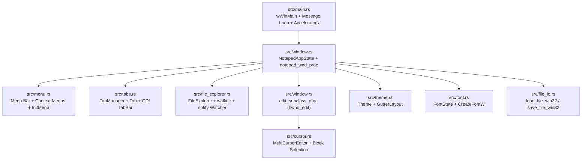

# Destination Codebase Audit (`D:\github\rust\notepad`)

## 1. Current Technology Stack & Component Inventory

| Layer | Current Implementation in `DST` (`notepad_win32`) | Source Files |
| :--- | :--- | :--- |
| **GUI Framework** | Native Win32 API (`windows = "0.62"`) + Custom Double-Buffered GDI (`Win32_Graphics_Gdi`) | `src/window.rs`, `src/main.rs` |
| **Editor Control** | Subclassed Win32 `"Edit"` control (`edit_subclass_proc`) with custom GDI overlay rendering | `src/window.rs` |
| **Text Buffer** | Flat `String` in `MultiCursorEditor` (`src/cursor.rs`) and `Tab` (`src/tabs.rs`), synced with `hwnd_edit` | `src/cursor.rs`, `src/tabs.rs` |
| **Multi-Tab & Sidebar** | `TabManager` (`src/tabs.rs`) + `FileExplorer` (`src/file_explorer.rs`) with `walkdir`, `notify`, `rfd` | `src/tabs.rs`, `src/file_explorer.rs` |
| **Theming** | Hardcoded 4-preset `Theme` struct (`MarianaDark`, `MonokaiDark`, `BreakersLight`, `ClassicNotepad`) | `src/theme.rs` |
| **Font Engine** | `FontState` with piecewise font size scaling (`8pt..128pt`) and GDI `CreateFontW` | `src/font.rs` |
| **File I/O** | Win32 `CreateFileW` / `ReadFile` / `WriteFile`, BOM detection (`UTF-8`, `UTF-8-BOM`, `UTF-16 LE/BE`), `.LOG` injection | `src/file_io.rs`, `src/save_dialog.rs` |

---

## 2. Current Architecture Diagram

### Current Rendering Loop
1. **`hwnd_main` (`notepad_wnd_proc` -> `WM_PAINT`):**
   - Calls `paint_chrome_hdc(hdc)`:
     1. `file_explorer.render_gdi(hdc, main_h, &theme)` — renders the left folder tree (`0..sidebar_w`).
     2. `tab_manager.render_gdi(hdc, sidebar_w, client_w, &theme)` — renders the top tab strip (`0..32px`).
     3. `paint_gutter_hdc(hdc)` — renders the line-number gutter (`sidebar_w..sidebar_w + gutter_w`).
2. **`hwnd_edit` (`edit_subclass_proc` -> `WM_PAINT`):**
   - Calls the native Win32 `"Edit"` control `WM_PAINT` (which draws monochrome `theme.foreground` text on `theme.background`).
   - Calls `render_multi_cursor_and_block_overlays()` to draw multi-cursor carets and rectangular block selections.
   - Calls `render_gutter_direct()` to keep the line-number gutter synchronized with scrolling.

---

## 3. Gap Analysis: What Needs to Change

### 3.1 Gaps for Incremental Syntax Highlighting
1. **No Rope Buffer for Large Files:**
   - Currently, `MultiCursorEditor` and `Tab` store text only as a flat `String`. Slicing by line index on a 10,000+ line document requires linear line scanning unless backed by `ropey::Rope` (`O(log N)` line lookup and byte-to-line indexing).
2. **No Lexer or Incremental Line-State Cache:**
   - There is no tokenizer or per-line state checkpoint cache.
   - To achieve `<16ms` tokenization on 10,000+ lines and `<1ms` on-typing latency, we need an incremental cache that stores `(ParseState, ScopeStack)` at the start of each line and only re-tokenizes from `dirty_line` forward until the end-of-line parser state converges with the next line's cached state.
3. **Monochrome Text Rendering in `hwnd_edit`:**
   - The native Win32 `"Edit"` control only supports a single foreground color (`WM_CTLCOLOREDIT`).
   - To display per-token syntax colors (`foreground`, `bold`, `italic`, `underline`) and bracket-matching highlights while preserving native editing, selection, and multi-cursor carets, `edit_subclass_proc`'s `WM_PAINT` pass must render the visible lines' colored token spans (`first_visible_line ..= last_visible_line`) using GDI `ExtTextOutW` / `TextOutW` and `EM_POSFROMCHAR` coordinates, followed by selection/caret overlays.

### 3.2 Gaps for Syntax Definitions
1. **No Language Registry or `.sublime-syntax` Loader:**
   - Currently, the editor has no concept of file syntax or language grammar.
   - We need `src/highlight/registry.rs` implementing a `SyntaxDefinition` trait (`name`, `file_extensions`, `scope`, `loader`) and `SyntaxRegistry` that loads `.sublime-syntax` YAML definitions from `D:\github\rust\notepad\assets\syntaxes\` (plus built-in `syntect` grammars) and detects syntax by **file extension** or **first-line regex / shebang**.
2. **No Per-Tab Syntax State or UI Selector:**
   - `Tab` (`src/tabs.rs`) needs a `syntax_name: String` field automatically detected on file open and changeable via `View > Select Syntax`.
   - The Status Bar needs to display the active tab's syntax name.

### 3.3 Gaps for Color Themes (`.tmTheme` & `.sublime-color-scheme`)
1. **Hardcoded `Theme` Struct Without File Loaders or Scope Rules:**
   - `src/theme.rs` currently contains 4 hardcoded `const fn` presets and only stores global chrome colors (`background`, `foreground`, `caret`, `gutter`, etc.) without any token scope rules (`comment.line`, `keyword.control`, `string.quoted`, `entity.name.function`, etc.).
2. **Need Modular `src/theme/` Package:**
   - Replace `src/theme.rs` with `src/theme/mod.rs`, `src/theme/loader.rs`, and `src/theme/manager.rs`:
     - Parse both `.tmTheme` XML Plist files (via `plist`) and `.sublime-color-scheme` JSON files (via `serde_json`, including `variables` substitution).
     - Map hierarchical scope stacks to `Style { foreground, background, bold, italic, underline }` via specificity scoring.
     - Load custom themes from `D:\github\rust\notepad\assets\themes\` via `ThemeRegistry` and support live switching from `Preferences > Select Theme` (`Format > Theme`).
